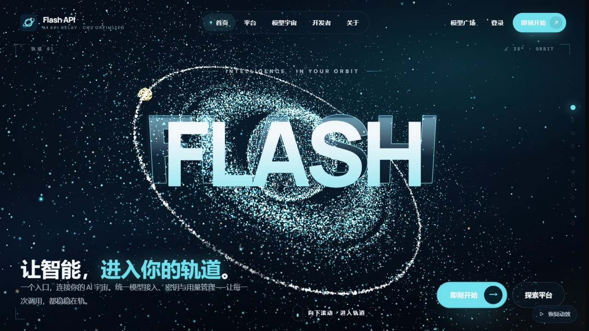
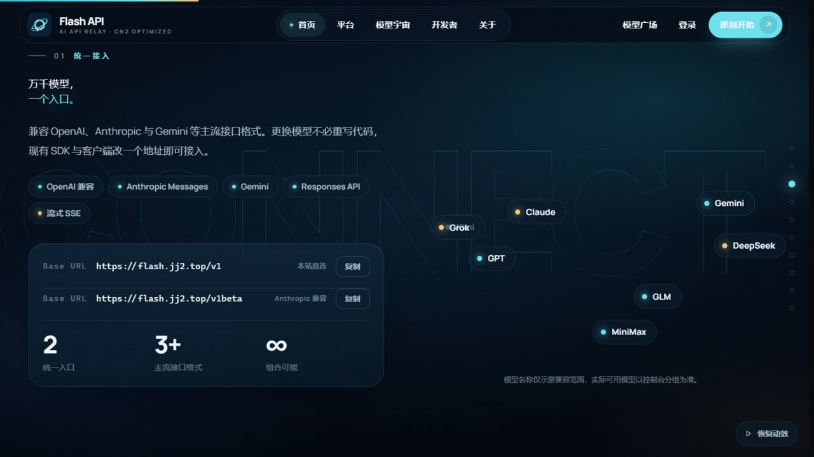
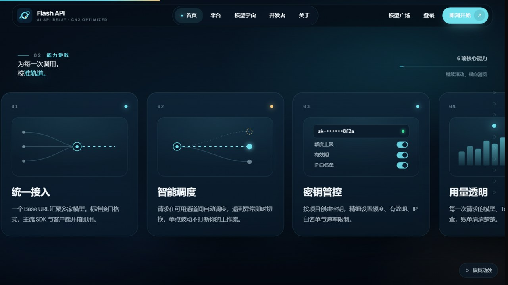
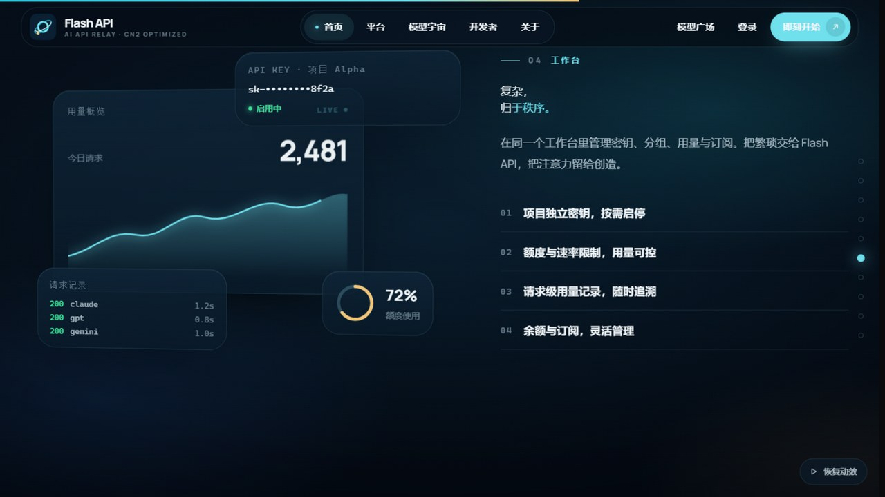
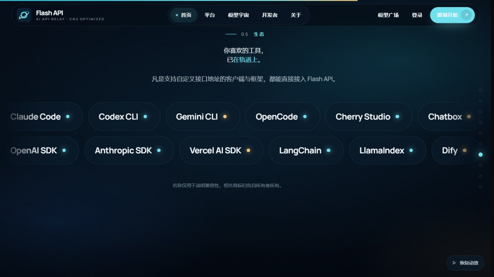
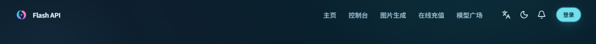

# Flash API

> 一个自托管的 AI API 网关：把多家模型收进一个入口，再配一套自己愿意每天打开的管理面板。
>
> A self-hosted AI gateway with a rebuilt interface. Built on top of New API.



## 目录

- [这是什么](#这是什么)
- [为什么做这个版本](#为什么做这个版本)
- [功能](#功能)
- [这一版改了什么](#这一版改了什么)
- [技术栈](#技术栈)
- [快速开始](#快速开始)
- [配置](#配置)
- [目录结构](#目录结构)
- [与上游的关系](#与上游的关系)
- [开发](#开发)
- [许可](#许可)

## 这是什么

Flash API 是一个 AI API 网关和管理面板。它把 OpenAI、Anthropic、Gemini 等不同格式的模型服务收束到同一个入口，提供渠道调度、令牌管理、额度计费、用量日志和一套面向站长的后台。

这个仓库是它的完整源码：Go 后端、React 前端、数据模型、部署文件和本次界面改造都在里面。

它适合这些场景：

- 团队内部统一管理多个模型供应商的 Key
- 给自己或小团队搭一个稳定的 API 入口
- 对外提供 API 服务，需要用户、令牌、计费和日志
- 想基于一个成熟网关改出自己界面的开发者

## 为什么做这个版本

New API 的后端能力已经很完整，默认界面也能用。但当它作为一个长期运行的服务面向用户时，默认界面的问题会逐渐显现：导航是通用配置、首页与面板割裂、主题缺少识别度、移动端和桌面端的层级不一致。

这个版本的出发点是：后端不动，把用户每天看到的那一层重新做一遍。

具体来说，做了三件事：

1. 用一套深空轨道主题统一面板的颜色、背景、卡片和动效。
2. 把顶部导航压缩成五条真正影响使用的路径。
3. 把首页从面板里拆出去，交给独立的静态页，面板只负责登录后的工作。

后端仍然保持与上游一致，升级时可以继续合并官方改动。

## 功能

### 统一入口

- 兼容 OpenAI Chat Completions / Responses、Anthropic Messages、Gemini 等接口格式
- 一个 Base URL 接入多家供应商
- 支持流式输出、函数调用、图片输入和多模态模型
- 支持模型重定向、参数覆盖和渠道级配置

### 渠道与调度

- 多渠道、多 Key、权重和优先级
- 失败重试与自动切换
- 渠道测速、模型检测和可用性监控
- 分组倍率、模型倍率和用户组管理

### 用户与令牌

- 注册、登录、OAuth、Passkey 和双因素认证
- 按项目创建令牌，设置额度、有效期、IP 白名单和速率限制
- 用户分组、邀请返利和兑换码
- 订阅与按量计费可以并存

### 计费与运营

- 按 Token 计费，支持缓存价格和分级价格
- 在线支付、订阅套餐、兑换码和余额
- 用量日志、审计日志、绘图任务日志
- 模型广场、排行榜和价格展示
- 公告、FAQ、工单和通知

### 界面

- 深空轨道主题：深色底、青色主色、星场和轨道动效
- 响应式布局，桌面侧栏和移动抽屉
- 中文、繁體中文、English、Français、日本語、Русский、Tiếng Việt
- 明暗主题切换，尊重系统的“减少动态效果”设置

## 这一版改了什么

| 改动 | 位置 | 说明 |
|---|---|---|
| 深空轨道主题 | `web/public/orbit.css`、`web/public/orbit.js` | 颜色变量、背景层、星场/轨道动画、主题开关 |
| 五项顶部导航 | `web/src/hooks/use-top-nav-links.ts` | 主页、控制台、图片生成、在线充值、模型广场 |
| 图片生成入口 | `web/src/routes/image-generation.tsx` | 跳到模型广场的 `image-generation` 筛选 |
| 根路由 | `web/src/routes/index.tsx` | `/` 进入控制台 |
| 首页路由 | `web/src/routes/home.tsx` | `/home` 回到 `/`，由 nginx 提供静态首页 |
| 旧路径兼容 | `web/src/lib/legacy-route.ts` | `/plaza`、`/register`、`/legal/*` 等映射到新路由 |
| 品牌 | `web/index.html`、`web/src/components/layout/components/footer.tsx` | Flash API 标题与页脚署名 |

这一版没有改后端的计费、调度和数据结构。升级上游时，冲突主要集中在上面这些前端文件。

## 界面

首页（静态页，由 nginx 单独提供）：


| 统一接入 | 能力矩阵 |
|---|---|
|  |  |

| 工作台 | 生态 |
|---|---|
|  |  |

面板顶部：



## 技术栈

| 层 | 使用 |
|---|---|
| 后端 | Go 1.26、Gin、GORM |
| 数据库 | SQLite、MySQL、PostgreSQL |
| 缓存/队列 | Redis（可选） |
| 前端 | React 19、Tailwind CSS 4、Base UI / shadcn 风格组件 |
| 路由与数据 | TanStack Router、TanStack Query、TanStack Table |
| 图表 | Recharts、VChart |
| 国际化 | i18next |
| 构建 | Bun、Rsbuild |
| 部署 | Docker、docker compose、nginx |

## 快速开始

### Docker（推荐）

```bash
SRC=/path/to/flash-api
cd "$SRC"
docker build -t flash-api:local .
```

把 `docker-compose.yml` 里的镜像改成刚构建的：

```yaml
services:
  new-api:
    image: flash-api:local
```

然后启动：

```bash
docker compose up -d
```

首次打开 `http://localhost:3000` 会进入初始化向导，按提示创建管理员。

### 二进制

```bash
SRC=/path/to/flash-api
cd "$SRC/web" && bun install --frozen-lockfile && bun run build
cd "$SRC" && go build -o flash-api .
```

前端产物会通过 `go:embed` 打进二进制。

### 静态首页与 nginx

`/` 和 `/home` 的静态首页是一个独立项目，不在本仓库里。仓库里的 `deploy/nginx.conf.example` 给出了反向代理和静态首页的接法：

- 面板反代到 `127.0.0.1:3000`
- `/`、`/home` 指向 `/opt/flash-home`
- 其余路径交给面板

把静态首页的构建产物放到 `/opt/flash-home`，或者修改 nginx 的 `root`。

## 配置

### 站点信息

后台「设置 → 站点」里可以改站点名称、Logo、文档地址、页脚 HTML 和公告。`web/index.html` 里的标题是静态兜底，改品牌时一起改。

### 顶部导航

导航项在 `web/src/hooks/use-top-nav-links.ts`：

- 主页 `/`
- 控制台 `/dashboard`
- 图片生成 `/image-generation`
- 在线充值 `/wallet`
- 模型广场 `/pricing`

`图片生成` 目前跳到模型广场的图片生成筛选。如果你有独立的生成页，改 `imageGenerationHref` 一行。

### 主题

`web/index.html` 里引入了：

```html
<link rel="stylesheet" href="/orbit.css" />
<script defer src="/orbit.js"></script>
```

删除这两行就回到官方外观。主题开关会记住用户的选择，减少动态效果的系统设置也会被尊重。

### 常用环境变量

| 变量 | 用途 |
|---|---|
| `SQL_DSN` | 数据库连接串；不填使用 SQLite |
| `REDIS_CONN_STRING` | Redis 连接串，可选 |
| `SESSION_SECRET` | 多实例部署时的会话密钥 |
| `TZ` | 时区，例如 `Asia/Shanghai` |
| `PORT` | 监听端口，默认 `3000` |

完整的变量列表见上游文档。

## 目录结构

```
web/public/orbit.css               主题样式
web/public/orbit.js                星场与轨道动效
web/src/hooks/use-top-nav-links.ts 顶部导航
web/src/routes/image-generation.tsx 图片生成入口
web/src/routes/index.tsx           根路由
web/src/routes/home.tsx            首页路由
web/src/lib/legacy-route.ts        旧路径映射
web/src/components/layout/         头部、页脚、布局
deploy/nginx.conf.example          nginx 示例
docs/screenshots/                  界面截图
NOTICE                             上游声明与本次修改记录
```

## 与上游的关系

这个项目基于 [New API](https://github.com/QuantumNous/new-api)，保留其后端、数据模型、计费与渠道能力。上游采用 AGPL-3.0，并带有第 7 条附加条款；本仓库继续使用同一许可证，并在 `NOTICE` 中保留上游声明和本次修改记录。

页脚保留了 New API 的署名与官方仓库链接，这是上游附加条款要求的。

这不是 New API 官方项目，问题和改动请提交到本仓库；上游文档仍然适用于后端配置和 API 行为。

## 开发

```bash
SRC=/path/to/flash-api
cd "$SRC/web"
bun install --frozen-lockfile
bun run dev        # 前端开发服务器
bun run typecheck  # 类型检查
bun run build      # 生产构建
```

后端：

```bash
cd "$SRC"
go run .           # 本地启动
go test ./...      # 测试
```

提交前至少跑一遍 `bun run typecheck` 和 `bun run build`。

## 许可

本项目按 **AGPL-3.0** 分发，许可证全文见 [LICENSE](./LICENSE)。

如果你修改后把它作为网络服务提供给用户，需要按 AGPL-3.0 提供对应的完整源码。公开本仓库即可满足这一要求。

需要非 AGPL 的商业授权，请联系上游作者。
